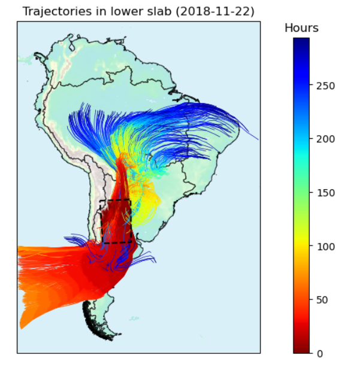

# run2LDRM

<!-- {width=125} -->


https://github.com/user-attachments/assets/603ad865-5d5d-43d0-951b-991f41df2e1f


<p align="center">
  
</p>


This repository contains the CLI program of the moisture tracking model 2L-DRM. The model’s primary output is $\rho$, the fraction of precipitation that originates as evaporation from different source regions. **The program is entirely written in Fortran and is computationally very efficient, since it was developed to work with high-resolution climate models**. 

This is a revised version of the original 2L-DRM model (https://doi.org/10.1175/JHM-D-19-0101.1). An article describing the theoretical details of this new version will be published soon, but they may not be necessary to know from a user’s perspective. **Since the program is new, any suggestions for making it easier to use are very welcome!**.

To build and compile it, you need to have the following installed:
1. A Fortran compiler that supports the module ieee_arithmetic is required (any compiler that implements the Fortran 2003 standard or higher should be fine). The tests pass with GNU gfortran 12.5 and Intel ifx 2025.3. 
2. Fortran Package Manager (fpm). See intructions for installing it here: https://github.com/fortran-lang/fpm. I installed it using a conda environment.
3. OpenMP library (optional). This allows parallelization, making the calculation much faster.

Then you can clone this repository in a local directory: 

    git clone https://github.com/erickjomp/2L-DRM.git

And you can build and install the 2L-DRM program using:

    fpm install --profile release

 This uses the default compiler (`gfortran`). To use another compiler, such as the Intel compiler `ifx`, add the `--compiler` option:

    fpm install --profile release --compiler ifx

In addition, if using a Linux system, you may want to add `~/.local/bin/` to your PATH environment. For that, you can edit your `~/.profile` file by adding a line like this:

    export PATH=~/.local/bin/:$PATH

Then you will be able to call the program `run2LDRM` from any directory.


## Running 2L-DRM

The inputs of `run2LDRM` (input files, grid, dates, tracing options, outputs, ...) can be given in a configuration file or as command-line arguments. **Using a configuration file is the preferred way**: it keeps all the settings of a run in one place, where they can be commented, reused and kept together with the results.

The full explanation of how to run the program and of all its options (a description of each one, whether it is required or optional, and its default value) is given by:

    run2LDRM --help

The next sections summarize the main ways to use them.

### Example

The repository includes a small example that runs in a few seconds: a coarsened version (32 x 26 cells, 7 days) of a 4 km simulation over the Amazon.

**1. Prepare the example (only needed for this example).** From the repository folder, load the input files and the configuration file of the example into a new folder (here `my_example`):

    python example/prepare_example.py my_example
    cd my_example

**2. Run 2L-DRM.** Now everything is ready to run the model. This is the only step needed in your own cases, once your input files and configuration file are prepared:

    run2LDRM --config amz2_coarse.toml

The results are written to `my_example/output/`. The configuration file of the example, `example/amz2_coarse.toml`, is a good starting point for your own runs.

### Configuration file

The configuration file is a text file that follows the [TOML](https://toml.io) format, and is passed with `--config` (or `-c`):

    run2LDRM --config my_run.toml

Each line sets one input as `name = value`, where the name is the long name shown by `run2LDRM --help`, without the leading `--`. Lines starting with `#` are comments. The `[sections]` are optional and only help to organize the file: their names are free and do not change how the inputs are read. Text values go between quotes, and dates can be written as `2018-06-01T00:00:00` or as text in the command-line format (`"2018-06-01_00:00:00"`). For example:

```toml
[input]
pathin = "/path/to/inputs/"
fileET = "ET.dat"
# ...

[grid]
nx = 1055
ny = 863
dx = 4000.0
dy = 4000.0

[time]
datetime0 = 2018-05-01T00:00:00
datetime_start = 2018-06-01T00:00:00
datetime_end = 2018-09-30T21:00:00
data_dt = 3

[tracing]
tracing_dt = 900
max_traxing = 720
solver = 3
```

A complete configuration file is the one of the example above (`example/amz2_coarse.toml`).

### Command-line arguments

Inputs can also be passed as command-line arguments, using their long name (e.g. `--nx 1055`) or their short name (e.g. `-nx 1055`). They can be used on their own:

    run2LDRM -pi /path/to/inputs/ -ET ET.dat -nx 1055 -ny 863 ...

or together with a configuration file, in which case the command-line arguments override the values in the file. This is useful to reuse one configuration file for several runs, e.g. changing only the output directory:

    run2LDRM --config my_run.toml -po other_output/


## Preparing input data
- The data in the input binary files of run2LDRM program should be in Fortran-like memory order (read more about it here https://manik.cc/2021/02/25/memory-order.html). As a rule of thumb, if you want an input binary file with dimensions (nx, ny, nslabs, ntimes) and you are going to write it from a Python numpy array, the numpy array must have dimensions (ntimes, nslabs, ny, nx), where nslabs should be 2.
- The precipitable water flux at the interslab (PWflux), which has to be provided as an input binary file, can be calculated by $\rho_{air} w_{wind} q$, where $\rho_{air}$ is the density of the air, $w_{wind}$ is the vertical wind velocity and $q$ is the specific humidity at the interslab pressure level.
- To make the model easier to use, a preprocessing program is also provided (https://github.com/erickjomp/2L-DRM-preprocessing). It takes standard WRF outputs as input and generates the necessary files for running the 2L-DRM.


## Testing (for developers)

Regression tests run the model on a small case (32 x 26 cells, 7 days) coarsened from a 4 km CPM simulation over the Amazon. They compare the outputs with stored reference results, and check that 1 and 4 OpenMP threads give identical results. They need Python 3 and [pytest](https://pytest.org):

    fpm build
    python3 -m pytest test/regression --exe $(fpm run run2LDRM --runner echo | tail -1)

This tests the default build (`gfortran` compiler, `debug` profile). To test another compiler, such as intel compiler `ifx`, or the optimized `release` profile, pass the same options to both fpm commands, for example:

    fpm build --compiler ifx --profile release
    python3 -m pytest test/regression --exe $(fpm run run2LDRM --compiler ifx --profile release --runner echo | tail -1)

A failure means the results changed, not necessarily that they are wrong. If a change in results is intended, regenerate the references with `--update-reference` and commit them. The tests also run automatically on GitHub Actions with gfortran and ifx, in both debug and release, for every push and pull request.
